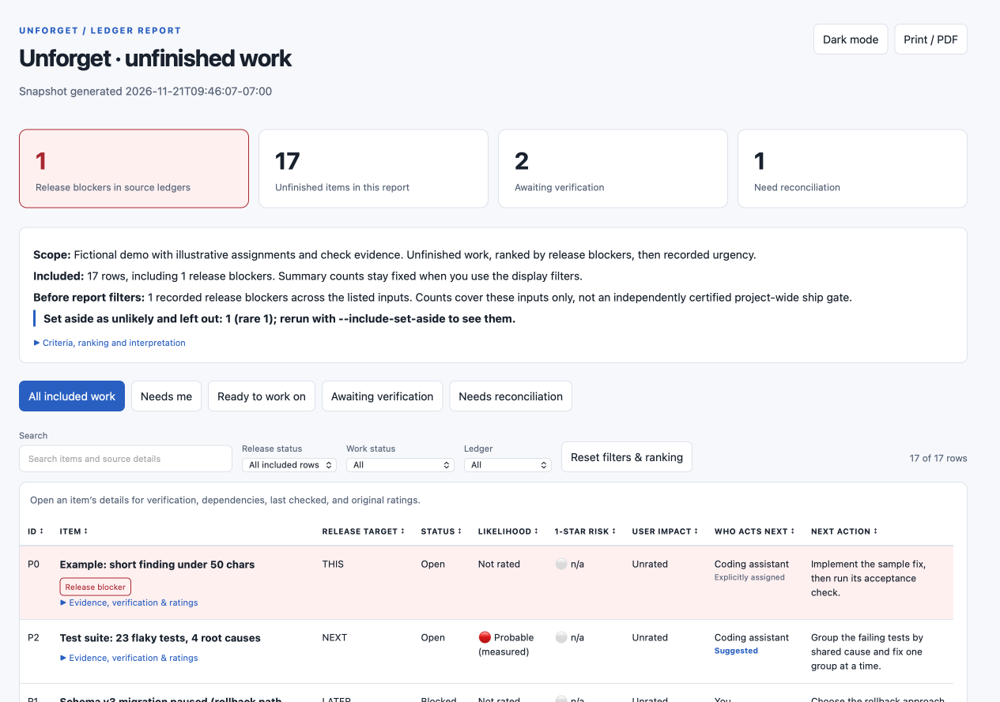
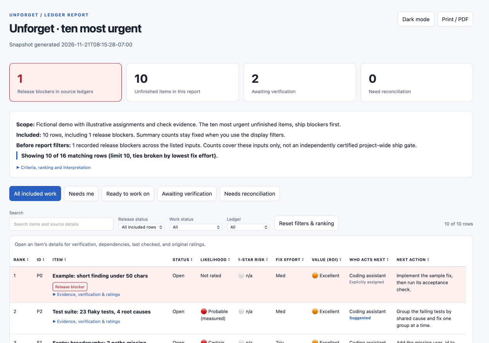
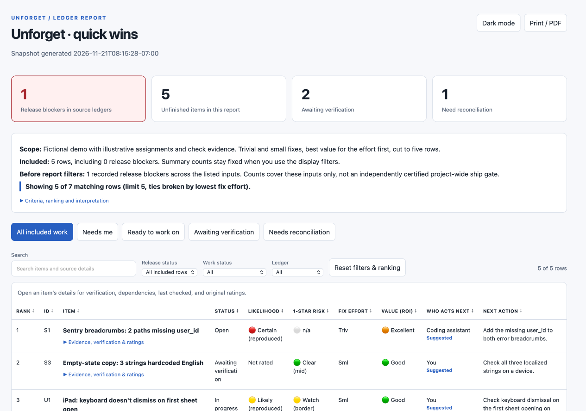
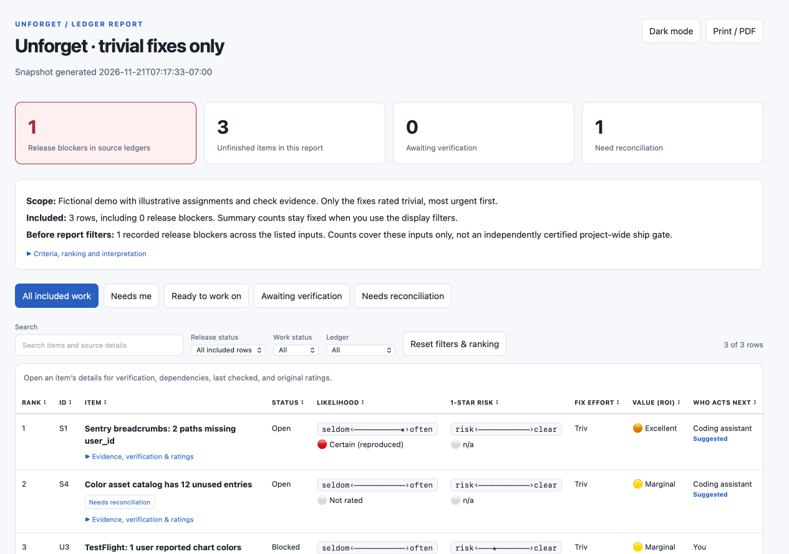
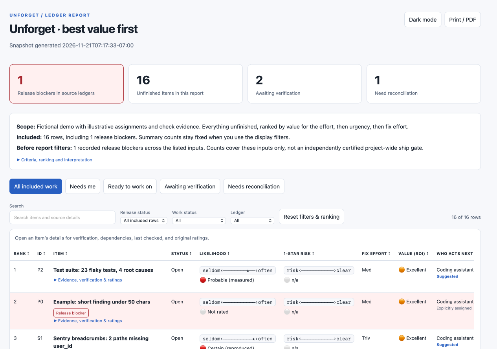
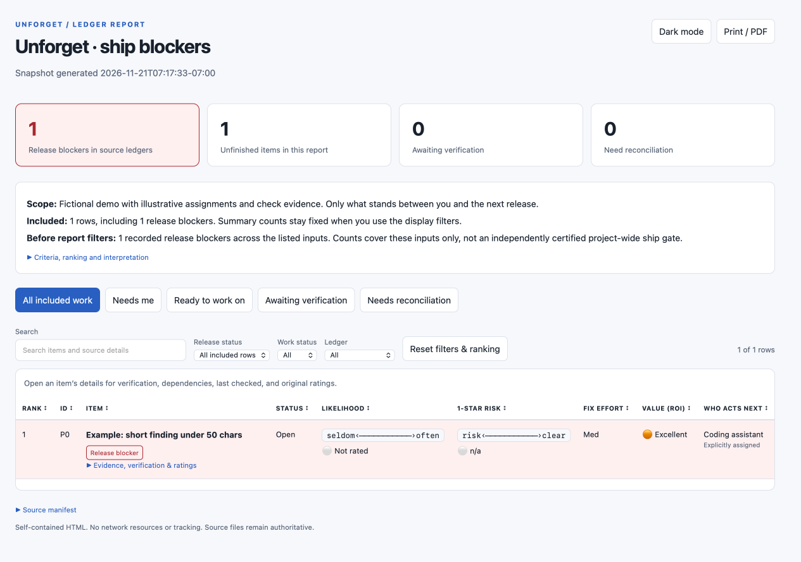

# Report examples

Every view below was generated from [UNFORGET.md](UNFORGET.md), the bundled sanitized sample
ledger. Each picture is a preview. **Open live** runs the real page in your browser, and
**Download** saves a copy that works offline. Either way you can try search, filters, sorting by
column title, expandable source details, dark mode and printing. (GitHub's file view shows a
page's HTML source rather than running it, which is why the live links go to the project's
GitHub Pages site.)

When unforget makes one of these for your own ledger, it opens the page in your browser as soon
as it's ready and tells you where the file is saved.

| View | What to type | Preview | Interactive page |
|---|---|---|---|
| **Unfinished work** (the default) | `/unforget report` | [](unfinished-ledger.png) | [Open live](https://terryc21.github.io/unforget/examples/unfinished-ledger.html) · [Download](https://github.com/Terryc21/unforget/raw/refs/heads/main/examples/unfinished-ledger.html) |
| **Top 10 by urgency** | `/unforget report: show me the ten most urgent things` | [](top-10.png) | [Open live](https://terryc21.github.io/unforget/examples/top-10.html) · [Download](https://github.com/Terryc21/unforget/raw/refs/heads/main/examples/top-10.html) |
| **Quick wins** | `/unforget report: quick wins` | [](quick-wins.png) | [Open live](https://terryc21.github.io/unforget/examples/quick-wins.html) · [Download](https://github.com/Terryc21/unforget/raw/refs/heads/main/examples/quick-wins.html) |
| **Trivial fixes only** | `/unforget report: only trivial fixes` | [](trivial-fixes.png) | [Open live](https://terryc21.github.io/unforget/examples/trivial-fixes.html) · [Download](https://github.com/Terryc21/unforget/raw/refs/heads/main/examples/trivial-fixes.html) |
| **Best value first** | `/unforget report: best value first` | [](best-value.png) | [Open live](https://terryc21.github.io/unforget/examples/best-value.html) · [Download](https://github.com/Terryc21/unforget/raw/refs/heads/main/examples/best-value.html) |
| **Ship blockers** | `/unforget report: ship blockers only` | [](ship-blockers.png) | [Open live](https://terryc21.github.io/unforget/examples/ship-blockers.html) · [Download](https://github.com/Terryc21/unforget/raw/refs/heads/main/examples/ship-blockers.html) |

**Reading the previews.** A view that was cut says so in plain sight, under its scope line:
"Showing 10 of 16 matching rows" on Top 10, "Showing 5 of 7" on Quick wins. On longer views the
table scrolls inside the page, so a preview shows the first rows only. The sample's illustrative
P0 row demonstrates a ship blocker. Completed and withdrawn work stays in the source but is left
out of these views. The default view leaves user impact Unrated because the sample records no assessment.
This is sample data, not a live release assessment.

**What the new display demonstrates.** The default view includes who acts next and a concrete
next action. Most assignments are visibly **Suggested**; one fictional assistant assignment
and one fictional teammate, Alex, demonstrate explicit assignments. The user label is **You**,
so this example never sets a name for your project. One item stays **Unassigned**.

**The two rating columns.** Every view also shows two optional columns, each a colored dot
and a word, so color is never the only cue. **Likelihood** reads the row's `@likelihood:`
rating and its basis, for example "🔴 Probable (measured)"; six sample rows are rated, and the
rest show "Not rated". **1-Star Risk** shows the band line of the ledger's own 1-Star Risk
cell, for example "🟡 Watch (mid)". To get them on your own report, add
`likelihood,onestar` to `--columns`.

Try the action filters above the table. Verification remains owed on unfinished checks;
reconciliation flags highlight conflicting evidence without changing the ledger's status.
The summary cards stay fixed while the table is filtered. Expand S1 to see a fictional dated
source check, separate from the report's generation date. A source check is not a device test.

These presentation-only examples live in [report-annotations.json](report-annotations.json).
All assignments, next steps, readiness assessments and check evidence in that file are
fictional illustrations. They are not evidence that the sample app was checked or changed.

## Regenerating

From the repository root, with Python 3.9 or later:

```bash
python3 examples/generate_html.py
```

The script uses the shared report generator and template and rewrites every page listed in its
`PAGES` table (name one, such as `python3 examples/generate_html.py quick-wins.html`, to
regenerate only that page). The sample ledger stays unchanged. Source paths are relative to the
repository root, and each page records the source checksum and generation time.

The previews are WebKit snapshots at a 1265 × 889 desktop viewport. Refresh all six PNG files
after a visible change to the report, on macOS, with
`swift examples/snapshot.swift examples/<page>.html examples/<page>.png`. Check the default view at a narrow viewport as well: each row
becomes a card with labeled fields.

For your own ledger, ask Codex `$unforget report`, or use `/unforget report` in Claude Code
(`/unforget:unforget report` for a plugin install). See the
[report options](../skills/unforget/reference/html-report.md) for custom scopes and rankings.
